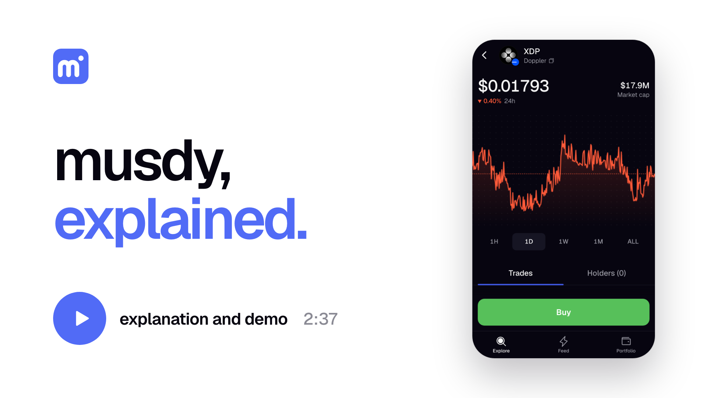
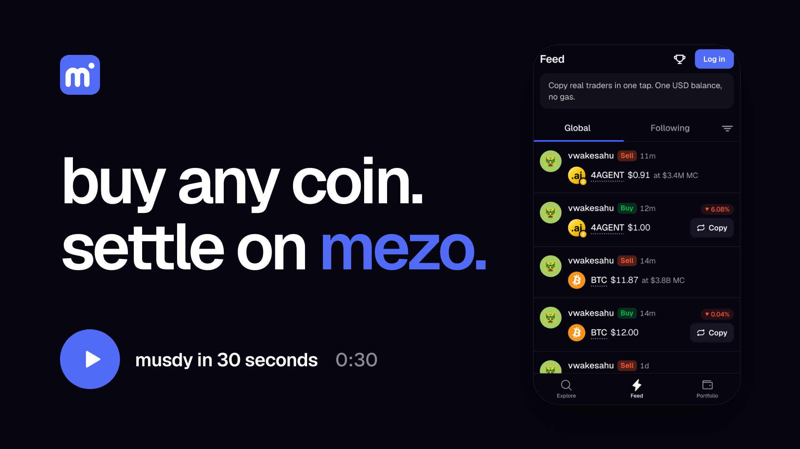
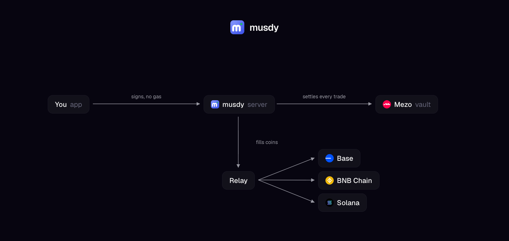
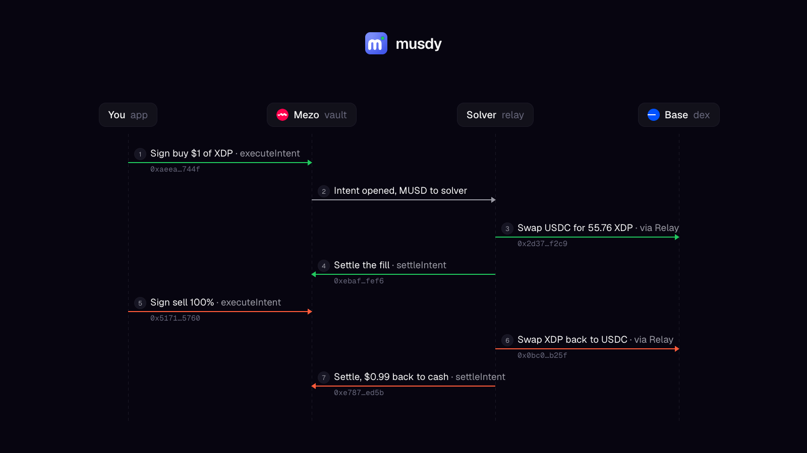

# musdy

fomo on mezo. you log in with google, you get one dollar balance, and you buy coins on solana, base and bnb chain, bitcoin and stocks, all from it. the feed shows every trade as it happens, who made it and how it's doing, and copying one is a single tap. you never see gas, a bridge or a wallet popup.

it's live at https://musdy.fun on mezo testnet, built by [@vwakesahu](https://x.com/vwakesahu). it's a beta, keep deposits to $10 or $20.

<a href="https://youtu.be/fXHEIvC3j_Q"></a> <a href="https://youtu.be/-kZQSVvRB5Q"></a>

## how it works

your balance is MUSD, mezo's dollar backed by bitcoin, and it sits in the musdy vault on mezo. you don't send transactions, you sign what you want and our relayer submits it and pays the gas. the vault only does what you signed, so the relayer can't move your money, and you can always pull it out of the vault without us.

bitcoin and stocks trade against mezo pools. coins on other chains go through our solver, it takes your MUSD in the vault, buys the coin on its own chain with relay, and settles the result back to the vault. a sell runs the same path backwards. a coin launched on musdy starts on a bonding curve and moves into its own mezo pool when the curve sells out, with the liquidity burned so it can't be pulled. every trade is 0.5%.

deposits come in two ways. send anything to the address the app gives you for a chain and relay bridges it, or send USDC straight to your own musdy address and the app sweeps it with a signed authorization, no gas from you. either way it lands as MUSD.

## architecture



the app signs, the server pays the gas and talks to the vault on mezo, and the solver fills coins through relay on base, bnb chain and solana. prices and charts come from dexscreener and geckoterminal, both public, no keys.

## proof

every link below is a real transaction. the vault and its ledger are on mezo testnet, the coins were bought and sold on base and bnb chain mainnet with real USDC.



the round trip in the picture is a $1 buy of XDP on base and the sell straight back to cash.

1. sign the buy, the vault opens the intent on mezo [`0xaeea…744f`](https://explorer.test.mezo.org/tx/0xaeeac1b41f5097bf6206d079178e1974bbe423e614f2c95581daac443573744f)
2. the solver approves USDC once for relay on base [`0x6a49…0db2`](https://basescan.org/tx/0x6a490c46a72c3b4e0b9aaf4c69a47e569b403bd7417bdf8eb19a854aba1b0db2)
3. the solver swaps USDC for 55.76 XDP on base [`0x2d37…f2c9`](https://basescan.org/tx/0x2d372b95efd35091de8b456f2162e20cfc0c598f86ef80ef595bc4b45eccf2c9)
4. the fill settles on mezo [`0xebaf…fef6`](https://explorer.test.mezo.org/tx/0xebaf310e780042fe03218a58df11ede88ebd489eba14157061f96bf0dbaffef6)
5. sign the sell, the vault opens it on mezo [`0x5171…5760`](https://explorer.test.mezo.org/tx/0x5171407a35198db939b6f78fcae35072d839c04fd81602c277564d21b9905760)
6. the solver swaps the XDP back to USDC on base [`0x0bc0…b25f`](https://basescan.org/tx/0x0bc0e1a0f24a0deada352e840c761c3c026a48b6d619f49a068e05a934c9b25f)
7. the sell settles, $0.99 back to cash on mezo [`0xe787…ed5b`](https://explorer.test.mezo.org/tx/0xe78735e598109db61f241822cd7588ed343a6b81049ebf80d5dc0b43026ced5b)

AGT lives on bnb chain, so its buy and sell each cross two chains.

- buy opened on mezo [`0x4707…0cde`](https://explorer.test.mezo.org/tx/0x4707aae657997ac279a7e35d39a0079598db59f0431ae24c6c46fc245b9f0cde), USDC into relay on base [`0x2dc9…921f`](https://basescan.org/tx/0x2dc917559f18b1ed4c7805041b9d9bc6f355b9da341d0e279d7a1720cf97921f), AGT delivered on bnb chain [`0xfd18…7d2a`](https://bscscan.com/tx/0xfd1890c415ac68d7aa123fdcde9b5212754924c69c7e4a359ac1df766ac27d2a), settled on mezo [`0xd397…3a44`](https://explorer.test.mezo.org/tx/0xd39785c0c952a65a538d20f0230bbe492d77719eb0d02c28f6f99d6d55943a44)
- sell opened on mezo [`0x5b15…1bfa`](https://explorer.test.mezo.org/tx/0x5b1509cc65703fc453dd42b0ba31f70d057b43df09b6d37ee071198e5ed61bfa), AGT into relay on bnb chain [`0xda85…af64`](https://bscscan.com/tx/0xda85f8b1c1182336b9ea7435db53fc0a79e05decefd42375de4584284e9baf64), USDC back on base [`0x5cee…9900`](https://basescan.org/tx/0x5cee38f158239e0f89576c03a4d664f3fb0c7f9a136f712a7b9554ebae279900), settled on mezo [`0x7bf4…e030`](https://explorer.test.mezo.org/tx/0x7bf41eb9ab8db1c65b103c166f8929de6d106ead98436552f3c5ce04b585e030)
- the solver topped up its own gas on bnb chain through relay [`0x1f81…c8e3`](https://basescan.org/tx/0x1f8139f7176e8f11b95f67cf9717b724a6bacc381878fd5478ae5bf1c0e2c8e3)

both ways of depositing land as dollars on mezo.

- USDC sent to a relay deposit address on base [`0x3c28…4827`](https://basescan.org/tx/0x3c28f1cc1defc35b410323abac9decded05130e43cbec1c3c04ac4d899be4827), credited on mezo [`0x433f…0ade`](https://explorer.test.mezo.org/tx/0x433fa8b124308408d6bcbf626d6e0a8024204974e9d59641dc3ae63aec300ade)
- USDC sent straight to your own musdy address on base [`0x214a…689c`](https://basescan.org/tx/0x214a128af2e1fcf58160092cbceb18cba5e231e996014d3f2bb244a82ee9689c), swept with a signed authorization and no gas from you [`0x9f68…1d4b`](https://basescan.org/tx/0x9f689aeaedf3cccbd8fe80be622fd49bf8e409606bf355cd73af9c2e18fc1d4b), credited on mezo [`0x95e9…1349`](https://explorer.test.mezo.org/tx/0x95e9ffc07b8003db032c3326ab8c0abe72ad698c5ae463a51b532263d5d51349)
- testnet faucet claim [`0x6e43…bdb8`](https://explorer.test.mezo.org/tx/0x6e43d0cddd403fc77f97f1b5ea64804c96d4c9935f75050fa424eaf0e955bdb8)

the vault is MusdyVault [`0xE6bd…1119`](https://explorer.test.mezo.org/address/0xE6bdDc38313ff3E1484109c82f0cA69200Fa1119) deployed in [`0x6625…8a03`](https://explorer.test.mezo.org/tx/0x6625407bae5049b846c257648e291696e52c1046d9ba942610c91921ae968a03) and the launchpad is MusdyLaunchpad [`0x8779…DFF6`](https://explorer.test.mezo.org/address/0x8779B801C6b0851008cA5955c0b413c4C8bADFF6) in [`0x7f2b…8480`](https://explorer.test.mezo.org/tx/0x7f2ba455e018bb32825fcc12c21e7e33c219e1d10fd780a5635380516f178480). the solver is [`0xc586…0a2b`](https://basescan.org/address/0xc586102Fd2206e349DDF9dDce83f49510ee20a2b) on every chain. nothing is on mezo mainnet yet, that comes after the buildathon.

## running it

copy `.env.example` to `.env`, then

```
pnpm install
anvil --block-time 1
cd contracts && forge script script/DeployLocal.s.sol --broadcast --rpc-url http://127.0.0.1:8545
cd server && bun --env-file=../.env src/index.ts
cd web && pnpm dev
```

everything else a developer needs is in docs/development.md.
